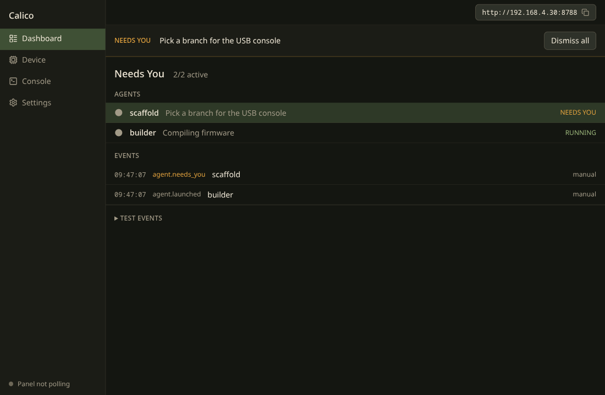
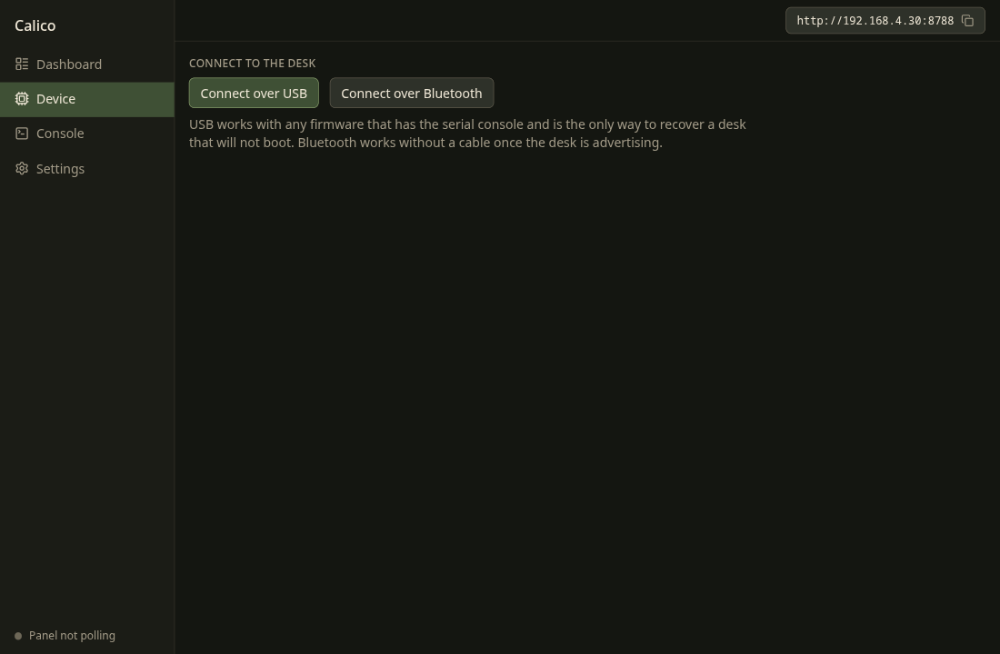

# Calico

Desktop app and developer kit for ginger, an ESP32-S3 AMOLED desk panel that shows what your coding agents are doing. This repository holds the app, the panel firmware, and the agent kits.

> Status: alpha. v0.1 targets Linux.

## What it does

- Runs Calico's server, which receives agent webhooks and which the panel polls (`/api/status` on port 8787 by default).
- Shows a dashboard of agents, events, and the panel's state.
- Sets up the panel over USB or Bluetooth: Wi-Fi (tested before it is saved), Calico's address, token, reboot.
- Keeps the panel's Wi-Fi networks in one list on this computer, with passwords locked in the system keyring (GNOME Keyring or KWallet). Without a keyring, Calico refuses to save a password.
- Pushes the saved networks to the panel over Bluetooth after showing exactly what it will add, update and remove, and offers a one-click Bluetooth fix when this computer's address changes and the panel goes quiet. A push releases one saved password at a time to the app window for the moment of the write, a deliberate exception to "the window never sees a password"; the vault list and every other call expose only whether a password or token is set.
- Lives in the tray and starts at login, so the panel keeps working when the window is closed.
- Optionally collects agent updates from a relay while the computer is off or on another network (see [Relay](#relay)).
- Optionally POSTs to one outbound webhook when the panel comes back and when a needs-you is dismissed (see [Outbound webhook](#outbound-webhook)).




Planned: firmware flashing and a first-run wizard, a screen simulator built from the real firmware UI, more agent integrations, macOS and Windows.

## Repository layout

| Path                      | What it is                                                                                                                                                     |
| ------------------------- | -------------------------------------------------------------------------------------------------------------------------------------------------------------- |
| `src/`                    | The Electron app: Calico's server, tray, dashboard, panel setup.                                                                                               |
| `firmware/`               | ESP-IDF firmware for the Waveshare ESP32-S3-Touch-AMOLED-2.16, with host tests and BLE/USB provisioning scripts. See [firmware/README.md](firmware/README.md). |
| `kits/ginger/`            | The Grok kit: the Grok Bot webhook guide and the original project README.                                                                                      |
| `tools/python-companion/` | The original Python version of Calico and its web UI, kept as the reference implementation the app's contract tests are captured from.                         |
| `docs/`                   | Protocol docs and design history.                                                                                                                              |

The firmware, kit, and the legacy Python app arrived with their git history from the old grokbot-buddy repository. That history is not in `main` (the import was squash-merged), but it is kept at the tag [`grokbot-buddy-history`](https://github.com/newtosh/calico/tree/grokbot-buddy-history). Check it out to run `git log` or `git blame` on the original commits.

## Install

Linux packages (AppImage, deb, pacman) are attached to each [release](https://github.com/newtosh/calico/releases). Each release lists SHA-256 checksums and a build provenance attestation:

```bash
sha256sum -c SHA256SUMS
gh attestation verify Calico-*.AppImage --repo newtosh/calico
```

### Arch and derivatives, straight from the URL

Each release also carries a detached signature, so pacman can install the package without a separate download. Add the release key, check its fingerprint, then trust it once:

```bash
curl -fsSL https://raw.githubusercontent.com/newtosh/calico/main/packaging/calico-release.asc | sudo pacman-key --add -
sudo pacman-key --finger A9F9FE8D26B68DD421EE52C8C491E349184FA884
sudo pacman-key --lsign-key A9F9FE8D26B68DD421EE52C8C491E349184FA884
```

The fingerprint line must read `A9F9 FE8D 26B6 8DD4 21EE  52C8 C491 E349 184F A884`. Stop if it does not. Then install or upgrade with:

```bash
sudo pacman -U https://github.com/newtosh/calico/releases/latest/download/Calico-x64.pacman
```

That URL always points at the newest app release, so the same command installs and upgrades. To pin a version, use `https://github.com/newtosh/calico/releases/download/app-v<version>/Calico-<version>-x64.pacman` and replace the version in both places. pacman fetches the `.sig` next to the package by itself. Signatures start with 0.1.4. The key expires on 2029-10-08.

The tray icon needs a StatusNotifier host. KDE and most panels have one. GNOME needs the AppIndicator extension.

On Ubuntu 24.04 and later, install the deb. It adds an AppArmor profile so Chromium's sandbox works. The AppImage still runs there, but its launcher turns the sandbox off because Ubuntu blocks the user namespaces it needs, and it needs `libfuse2t64` installed. CI launches both on stock Ubuntu 24.04.

## Relay

Agents that run in the cloud cannot reach a computer whose address changes with the Wi-Fi network. A relay is a small mailbox on the public internet: agents post to it, it keeps a rolling window (24 hours, 200 messages), and Calico collects what is waiting when it is on. Replayed updates keep the time they were sent, so a stale one never makes an agent look Running.

In Settings, Relay, either:

- **Set up with Cloudflare**: Calico opens your browser, you approve one permission (Workers Admin) on Cloudflare's consent screen, and Calico deploys a Worker called `calico-relay` to your own free Cloudflare account, checks it, and revokes its own access. If anything fails it removes what it uploaded. Then **Copy for Grok Bot** copies the address and the send token. Agents must send a `User-Agent` header: Cloudflare turns away Python's default `Python-urllib`.
- **Connect an existing relay**: an address and a read token, for the Worker above or a self-hosted [ntfy](https://ntfy.sh).

The Worker's source is in [`tools/relay`](tools/relay), with its tests. Privacy and what the sign-in does are on the [project site](https://calico.newto.sh/#cloudflare).

## Outbound webhook

Calico can POST to one webhook you run. It sends `calico.online` when the panel polls again after Calico has not heard a panel poll for a threshold (180 seconds unless you change it). `offline_seconds` is that gap: how long Calico has not heard the panel, which includes the laptop sleeping. The first poll after Calico starts does not send, because there is no gap yet. It sends `needs_you.dismissed` when you dismiss an agent that was waiting. Dismiss-all sends one POST for each agent whose lamp actually went out, and sends nothing when nothing was waiting.

In Settings, Connectivity, next to Relay:

- **Address**: an `https` URL, stored as you type it, including a trailing slash. Plain `http` is refused for a public hostname. It is allowed for `localhost` (and `::1`, and `127.0.0.0/8`), private addresses (`10.0.0.0/8`, `172.16.0.0/12`, `192.168.0.0/16`), the shared range `100.64.0.0/10` (CGNAT, which is what Tailscale uses), names ending in `.local`, and `*.ts.net`. Settings warns when the address is `http` and a sender key is set, because the key would travel in the clear. Changing the address without typing a new key clears the saved key. `GET /api/notify` and Settings show the address with its path and query masked (`https://hooks.example/…`), since some webhook URLs are themselves credentials. The POST still uses the full address.
- **Sender key**: sealed with the system keyring (GNOME Keyring or KWallet), the same way Wi-Fi passwords are. Calico refuses to save it if there is no keyring, because the alternative is plain text. The key is never shown again, never logged, and never returned by `GET /api/config`, `/api/panel`, `/api/relay`, or `/api/notify`. Settings shows only that a key is set. Remove key clears it without clearing the address.
- **Header**: leave it blank for `Authorization: Bearer <key>`. A custom header name sends the raw key as that header's value, with no `Bearer` prefix. `Content-Type`, `User-Agent`, `Host`, and `Content-Length` are reserved and refused.
- **Offline threshold**: seconds without a panel poll before the next poll counts as coming back. Default 180, from 30 to 86400.

The POST uses `Content-Type: application/json` and `User-Agent: calico/<version>`, with a 5 second timeout. Calico does not wait for the reply, so a slow webhook cannot stall the panel or the window. It retries twice, waiting 0.5s and then 2s, on a network error, a timeout, HTTP 429, or HTTP 5xx. A 429 waits for `Retry-After` instead when that header is a delay in seconds or an HTTP date, capped at 30 seconds. Any other HTTP status, including a redirect, is final. Each POST carries an `id` that stays the same across retries, so a receiver can drop a duplicate. Settings shows the recent results, without the key.

`calico.online` (the battery is `null` until the panel has reported one):

```json
{
  "type": "calico.online",
  "id": "6b1e0c3a-9f2d-4a7e-8c11-2d4f6a8b0c1d",
  "at": "2026-10-14T20:41:00Z",
  "offline_seconds": 180,
  "battery": { "pct": 81, "charging": true, "external": true }
}
```

`needs_you.dismissed`:

```json
{
  "type": "needs_you.dismissed",
  "id": "6b1e0c3a-9f2d-4a7e-8c11-2d4f6a8b0c1d",
  "agent_id": "grok",
  "at": "2026-10-14T20:41:00Z"
}
```

## Develop

Requires Node 22.12+ and pnpm 11.

```bash
pnpm install
pnpm dev
```

Checks: `pnpm lint && pnpm typecheck && pnpm test && pnpm build`. Firmware host tests: `firmware/host/run.sh`. See [CONTRIBUTING.md](CONTRIBUTING.md).

## Security

Calico's server listens on your LAN with no accounts. Anyone on the same network can read status. Writes require the bearer token when one is set. Do not port-forward it. Report vulnerabilities through [SECURITY.md](SECURITY.md).

## License

MIT. See [LICENSE](LICENSE).
